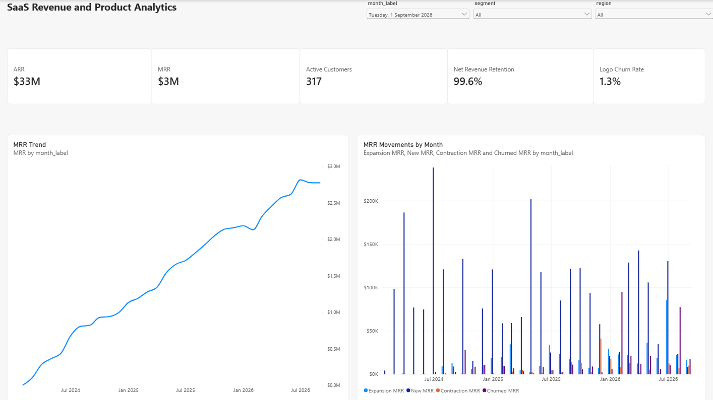
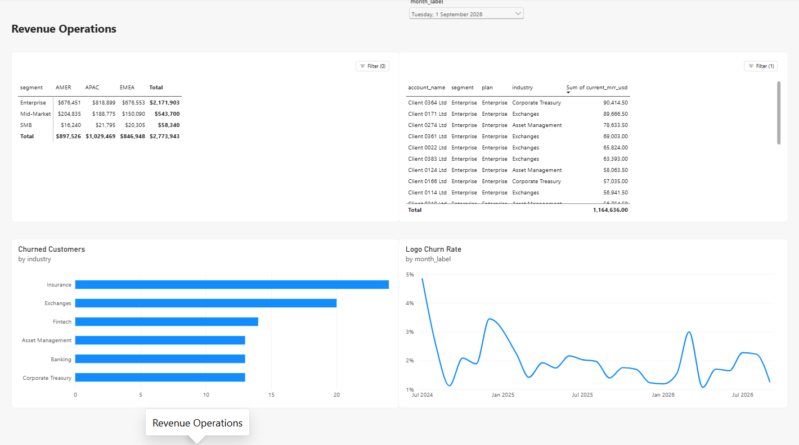
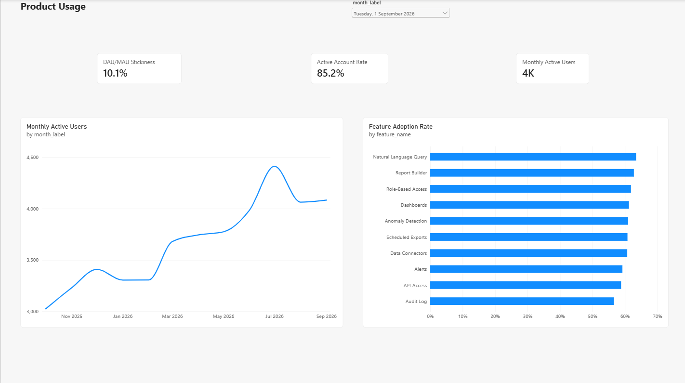
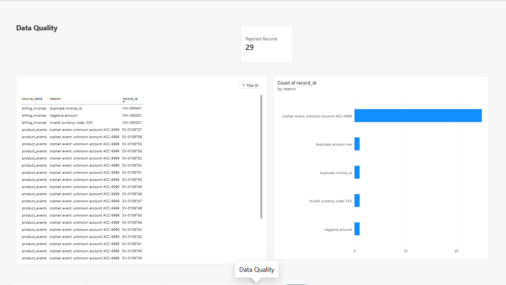
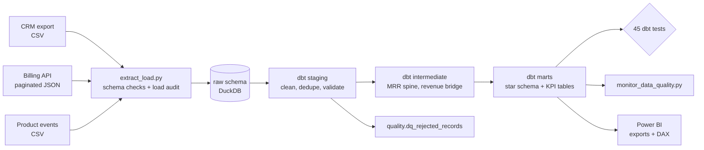

# SaaS Revenue & Product Analytics: ELT Pipeline, dbt Models and Power BI
[](https://github.com/Coder-Chauhan/saas-revenue-analytics/actions/workflows/ci.yml)

An end-to-end analytics engineering project for a fictional B2B SaaS company that sells an analytics
platform to financial-services clients. It combines three source systems (CRM, billing API and
product-usage events) into a tested dimensional model in a DuckDB warehouse. On top of that it
provides documented KPI definitions, automated data-quality monitoring, Power BI-ready datasets and CI.

> **Data note:** all source data is synthetic, generated by `scripts/generate_sources.py` with a fixed
> seed so results are reproducible. It is not real customer or financial data. Realistic data-quality
> issues (duplicates, bad currency codes, negative amounts, orphan events) are injected on purpose.

## Dashboard

Power BI report built on the dbt star schema (`reports/saas_analytics.pbix`). All 22 DAX measures
are in [docs/powerbi_measures.tmdl](docs/powerbi_measures.tmdl) and can be applied in one step from Power BI's TMDL view.

**Executive Summary:** ARR, MRR, active customers, net revenue retention and logo churn, with the MRR trend and monthly MRR movements.


**Revenue Operations:** MRR by segment and region, top customers, churn by industry and logo churn trend.


**Product Usage:** monthly active users, active account rate, DAU/MAU stickiness and feature adoption.


**Data Quality:** records quarantined by validation, by reason.


## What it covers

| Area | Implementation |
|---|---|
| ETL/ELT from multiple sources | Python extract-load of a CSV export, a paginated JSON API dump and a product event stream into a `raw` schema, with schema checks and a load-audit table |
| Data modelling | dbt staging, intermediate and mart layers, with a star schema (`dim_customers`, `dim_date`, `dim_features` and four fact tables) |
| Advanced SQL | CTEs, window functions (`lag`, `row_number`, running sums), date spines with `generate_series`, conditional aggregation |
| Reusable analytical datasets | Revenue bridge (`fct_mrr_monthly`), product usage (`fct_product_usage_daily`), feature adoption, and monthly KPI marts |
| Documented KPIs | MRR, ARR, NRR, GRR, logo churn, ARPA, MAU, DAU/MAU, active account rate, feature adoption ([docs/kpi_definitions.md](docs/kpi_definitions.md)) |
| Data validation and monitoring | 45 dbt tests (uniqueness, not null, relationships, accepted values, revenue reconciliation) plus a monitoring script for load health, volume drift, quarantined records and KPI anomalies |
| BI and dashboards | Power BI export, relationship map, 20+ DAX measures and a 4-page report spec for executives and operational users ([docs/powerbi_guide.md](docs/powerbi_guide.md)) |
| Software practices | Git, GitHub Actions CI that runs the full pipeline and tests on every push, reproducible one-command build |

## Architecture



### dbt layers

| Layer | Models | Purpose |
|---|---|---|
| `staging` | `stg_crm__accounts`, `stg_billing__subscriptions`, `stg_billing__invoices`, `stg_product__events`, `stg_product__features` | One model per source: types, de-duplication, standardisation, validation |
| `intermediate` | `int_account_mrr_monthly`, `int_mrr_movements` | Continuous account-month spine and MRR movement classification |
| `core` | `dim_customers`, `dim_date`, `dim_features` | Conformed dimensions shared by every fact |
| `finance` | `fct_invoices`, `fct_mrr_monthly`, `kpi_revenue_monthly` | Revenue facts and monthly revenue KPIs |
| `product` | `fct_product_usage_daily`, `fct_feature_adoption_monthly`, `kpi_product_monthly` | Usage, adoption and engagement KPIs |
| `quality` | `dq_rejected_records` | Every excluded source record, with the reason |

## Results (Oct 2025 to Sep 2026)

| Metric | Value |
|---|---|
| Source volume | 420 accounts, 5,865 invoices, 109,757 product events across 3 systems |
| ARR (Sep 2026) | $33.3M from 317 paying customers |
| Average monthly logo churn | 1.7% |
| Average monthly net / gross revenue retention | 99.6% / 98.5% |
| Monthly MRR churn by segment | SMB 2.6%, Mid-Market 1.1%, Enterprise 0.9% |
| Active account rate | 85% of paying accounts use the product each month |
| Records quarantined by validation | 29 (duplicates, invalid currency, negative amount, orphan events) |
| dbt build | 17 models and 45 tests, all passing |

## Run it

```bash
pip install -r requirements.txt
./run_pipeline.sh
```

This generates the sources, loads the warehouse, runs `dbt build` (models and tests), writes
`docs/data_quality_report.md`, and exports the Power BI tables to `exports/powerbi/`.

Other useful commands:

```bash
dbt build --profiles-dir .                         # models + tests
dbt docs generate --profiles-dir . && dbt docs serve --profiles-dir .   # browsable lineage and docs
```

## Project structure

```
scripts/
  generate_sources.py       synthetic CRM, billing and product data (3 source formats)
  extract_load.py           EL into the raw schema with schema checks and load audit
  monitor_data_quality.py   load health, volume drift, quarantined records, KPI anomalies
  export_for_powerbi.py     star schema + KPI tables to CSV for Power BI
models/
  staging/  intermediate/  marts/{core,finance,product,quality}/
tests/                      revenue reconciliation and KPI bound tests
macros/                     safe_divide, schema naming
docs/
  kpi_definitions.md        single source of truth for every KPI
  powerbi_guide.md          relationships, DAX measures and report layout
  data_quality_report.md    generated on every run
.github/workflows/ci.yml    runs the whole pipeline and tests on every push
```

## Moving to a cloud warehouse

The models use standard SQL, so the project can run on Snowflake, BigQuery or Databricks by changing
the dbt adapter and `profiles.yml`. The one DuckDB-specific function to replace is `generate_series`
(used in `dim_date` and the MRR spine), for example with a date-spine macro.
